# StepIt Commander Architecture

## Table of Contents <!-- omit in toc -->

- [Introduction](#introduction)
- [The Big Picture](#the-big-picture)
- [The Packages](#the-packages)
- [The Server and Its Five Hooks](#the-server-and-its-five-hooks)
- [Loading the Plugins and the Trees](#loading-the-plugins-and-the-trees)
  - [At the Start](#at-the-start)
  - [Before Each Goal](#before-each-goal)
  - [Objectives and Subtrees](#objectives-and-subtrees)
- [The Payload and the Blackboard](#the-payload-and-the-blackboard)
- [A Goal from a Client](#a-goal-from-a-client)
- [How a Run Ends](#how-a-run-ends)
- [Preemption](#preemption)
- [The Execution Status](#the-execution-status)
  - [The Feedback of the Goal](#the-feedback-of-the-goal)
  - [The Latched Topics](#the-latched-topics)
  - [The Progress of a Node](#the-progress-of-a-node)
- [Threads](#threads)
- [What the Server Asks of a Plugin](#what-the-server-asks-of-a-plugin)
- [BehaviorTree.ROS2, Our Fork](#behaviortreeros2-our-fork)
- [Tests](#tests)
- [How to Extend the Server](#how-to-extend-the-server)
- [Design Decisions and Trade-offs](#design-decisions-and-trade-offs)

## Introduction

This document explains how StepIt Commander is built: the action server, how it loads a robot's behaviors and objectives, how a goal becomes a running tree, how a new goal replaces it, and what the server tells its clients while a tree runs. It describes the code as it is, with BehaviorTree.ROS2 at the commit [`stepit.repos`](../stepit.repos) pins. It assumes we have read the [README](../README.md) and sent the server a goal once.

It follows one idea: **the server is generic: it knows nothing about any robot, and a robot plugs in through parameters**. `stepit_server` names no robot topic, action, service, behavior or objective. A robot gives it two lists of folders, `plugins` and `behavior_trees`, and the server runs whatever they hold.

Two words come back in every section. An **objective** is a behavior tree a client may ask for by name, the main tree of an XML file. A **behavior** is a node of such a tree, written in C++ in a plugin of the robot.

## The Big Picture

The module is one program, `stepit_server`, and the rosbridge its launch file starts beside it. The program is `CommanderServer`, a class derived from `BT::TreeExecutionServer` of [BehaviorTree.ROS2](https://github.com/kineticsystem/BehaviorTree.ROS2): the base class owns the `ExecuteTree` action, the BehaviorTree.CPP factory and the loop that ticks a tree, and calls five hooks, which `CommanderServer` fills with three helpers of its own.

<!-- The source is diagrams/big-picture.mmd: change it, then run bin/render-diagrams.sh. -->
<p align="center"></p>

The interface of the module, with the names the launch file gives: the node is `stepit_server`, so `~/objective` is `/stepit_server/objective`.

| Name | Type | What it does |
|---|---|---|
| `/commander/execute_objective` | `btcpp_ros2_interfaces/action/ExecuteTree` action | Run an objective: `target_tree`, its name, and `payload`, its parameters as a YAML map. Feedback while it runs, see [The Feedback of the Goal](#the-feedback-of-the-goal); the result is `node_status` and `return_message`, see [How a Run Ends](#how-a-run-ends). |
| `~/objective` | `std_msgs/msg/String` topic, latched | The name of the objective running, empty when none. |
| `~/execution` | `std_msgs/msg/String` topic, latched | The last run, running or ended, as one JSON object: the tree, the last status of every node that has run, the progress of the running ones, and how it ended. |
| `/get_loaded_trees` | `btcpp_ros2_interfaces/srv/GetTrees` service | The IDs of the trees registered in the factory, objectives and subtrees alike. It comes with `TreeExecutionServer`. |
| `groot2_port`, `1667` | a port of BehaviorTree.CPP's `Groot2Publisher` | For Groot2. `TreeExecutionServer` creates the publisher again for each tree. |
| rosbridge, port `9090` | WebSocket | Every topic, service and action of the ROS graph as JSON, for web pages. |
| `action_name`, `tick_frequency`, `ros_plugins_timeout`, `groot2_port`, `plugins`, `behavior_trees` | parameters of `TreeExecutionServer` | The name of the action, the ticks per second, how long a behavior waits for its server, and the folders to load, as `package_name/subfolder`. |
| `preempt`, `true` | parameter of `CommanderServer` | Whether a goal replaces the running objective, or waits for it to end. |
| `execution_period`, `0.2` | parameter of `CommanderServer` | The shortest time between two snapshots on `~/execution`, in seconds. |
| `params_file` | launch argument | The parameter file of the robot, loaded after the server's own. |
| `rosbridge`, `true`, and `rosbridge_port`, `9090` | launch arguments | Whether to start rosbridge, and its port. |

[`stepit_server.yaml`](../src/stepit_server/config/stepit_server.yaml) sets `action_name` to `commander/execute_objective`, `tick_frequency` to 100 and `ros_plugins_timeout` to 2000 ms, and lists no folder. [`commander.launch.py`](../src/stepit_server/launch/commander.launch.py) gives the node that file and then `params_file`, so the robot's file only holds what it changes. Without `params_file` the server starts and has no objective to run. StepIt Macro, for example, passes the section `stepit_server` of its `rig.yaml`, with the two folders and the parameters of its own behaviors.

## The Packages

| Package | Owns | Depends on | Must never |
|---|---|---|---|
| `stepit_server` | The static library `stepit_server`: `CommanderServer`, `parsePayload`, `TreeLoader`, `ExecutionStatus` and `SnapshotPacer`. The program `stepit_server`, which is [`main.cpp`](../src/stepit_server/src/main.cpp). The header-only target `stepit_server::progress`. The server's parameter file and its launch file. | `behaviortree_ros2`, `btcpp_ros2_interfaces`, `behaviortree_cpp`, `rclcpp`, `std_msgs`, `yaml-cpp`; `rosbridge_server` to run | Name a robot topic, action, service, behavior or objective, list a robot's folder in its parameter file, or depend on a robot's package. |
| `stepit_server_tests` | Every test of the server. | `stepit_server`, `rclcpp_action`, gtest | |
| `behaviortree_ros2`, `btcpp_ros2_interfaces` | `TreeExecutionServer`, the wrappers for nodes that call ROS, and the `ExecuteTree` action. Our fork, pinned in [`stepit.repos`](../stepit.repos) and imported into `modules` by `bin/update.sh`, and by CI. | | Be changed here: see [BehaviorTree.ROS2, Our Fork](#behaviortreeros2-our-fork). |

The includes and the links as they are, from the two `CMakeLists.txt`:

<!-- The source is diagrams/packages.mmd: change it, then run bin/render-diagrams.sh. -->
<p align="center"></p>

No edge points from the server to a robot. The one edge that comes from a robot is to `stepit_server::progress`, a single header that includes nothing but `<optional>`: a plugin implements `ProgressReporter` and links nothing of the server.

The library is static because `behaviortree_ros2` is itself a static library built without `-fPIC`: a shared library could not link it.

Inside the library, the helpers do not know the server. [`payload.hpp`](../src/stepit_server/include/stepit_server/payload.hpp) and [`tree_loader.hpp`](../src/stepit_server/include/stepit_server/tree_loader.hpp) include BehaviorTree.CPP only, [`execution_status.hpp`](../src/stepit_server/include/stepit_server/execution_status.hpp) adds `progress.hpp`, and none of the three includes `rclcpp`: only [`stepit_server.hpp`](../src/stepit_server/include/stepit_server/stepit_server.hpp) does. Their tests therefore need no ROS node.

## The Server and Its Five Hooks

`TreeExecutionServer` receives a goal, creates the tree on a new thread, ticks it until it ends, and sends the result. `CommanderServer` ([`stepit_server.cpp`](../src/stepit_server/src/stepit_server.cpp), 211 lines) overrides its five hooks, and adds two parameters and two publishers in its constructor.

| Hook | Called | What `CommanderServer` does |
|---|---|---|
| `onGoalReceived(tree, payload)` | when a goal arrives, on a thread of the executor; `false` rejects the goal | Parses the payload, reloads the trees if a file changed, and rejects a tree that does not exist or is not an objective. If a tree runs and `preempt` is true, asks it to end. |
| `onTreeCreated(tree)` | once the tree is created, on the thread of the goal | Unsets the previous payload in the global blackboard and writes the new one. Publishes the name on `~/objective`. Creates the `ExecutionStatus` of the run, numbered from 1, its `SnapshotPacer`, and a `BT::StdCoutLogger`, which prints every status change. Clears the preemption request and sets `running_`. |
| `onLoopAfterTick(status)` | after each tick; a status ends the run | Remembers the status of the tick. Returns `FAILURE` if the tree still runs and a preemption was requested. |
| `onLoopFeedback()` | after each tick; a string is sent as feedback | Returns the statuses that changed, and publishes a snapshot on `~/execution` when one is due. |
| `onTreeExecutionCompleted(status, was_cancelled)` | at every end of a run; a string replaces `return_message` | Publishes the last snapshot on `~/execution` and an empty name on `~/objective`, clears `running_`, and returns `Preempted by objective '<name>'` for a preempted run. |

The base class has a sixth hook, `registerNodesIntoFactory`, which the server leaves empty: a behavior registered there would be a behavior the server knows.

The detail that is easy to break: **the hooks run on two threads**. `onGoalReceived` runs on the executor while the four others run on the thread of the running goal, so `onGoalReceived` only touches what [Threads](#threads) lists as shared.

## Loading the Plugins and the Trees

### At the Start

`TreeExecutionServer` registers everything on a timer 1 ms after the node starts to spin (`executeRegistration`). For each folder of `plugins`, it finds the share directory of the package, and loads every `.so` file of the subfolder that exports a BehaviorTree.CPP plugin, with `BT_PLUGIN_EXPORT` or the ROS variant, which also receives the server's node and `ros_plugins_timeout`. For each folder of `behavior_trees`, it registers every `.xml` file. A package that is not found is logged and skipped, and so is a plugin or a file that fails to load; the server starts anyway. A package that is found but lacks the subfolder is not: the `directory_iterator` of the fork throws, and the process ends at the start.

`execute()` calls `executeRegistration` again before it creates a tree, when the parameters of the node changed since the last registration: the generated parameter listener of BehaviorTree.ROS2 reports any change. The trees are then registered again from the installed folders alone, without `TreeLoader` knowing, see [What the Server Asks of a Plugin](#what-the-server-asks-of-a-plugin).

### Before Each Goal

A goal runs the trees as they are on disk. `CommanderServer::reloadTrees`, called from `onGoalReceived`, resolves the folders of `behavior_trees` and asks [`TreeLoader`](../src/stepit_server/src/tree_loader.cpp) to reload them if anything changed:

- **The files** are the `.xml` files of each folder, and of every folder a link of it points to. A package built with `colcon build --symlink-install` installs one link per source file, so an edit shows through the link, but a file added to the source folder has no link until the next build: reading the folder the links point to finds it. Each file counts once, by its canonical path.
- **A file with no `<BehaviorTree`** in its text is left out, e.g. a file of node models for an editor.
- **A change** is a file that is new, gone, or whose modification time or size differs from the last load. The first call always loads.
- **A reload replaces every tree**: `clearRegisteredBehaviorTrees()`, then every file again. A file that fails to parse is logged with its error, and the others load.

The plugins are never loaded again: a new or changed behavior needs a build and a restart of the server.

The price is that every goal lists the folders and reads every XML file once, to look for `<BehaviorTree`, before it compares the times.

### Objectives and Subtrees

At each reload, `TreeLoader` records the main tree of each file: the `main_tree_to_execute` attribute of its `<root>` tag, read with a regular expression after the comments are removed (`mainTree`). These are the objectives. `onGoalReceived` rejects a goal for any other registered tree, a subtree, which only runs inside another tree. A file whose `<root>` has no `main_tree_to_execute` holds subtrees only.

A rejection is an error in the log of the server, with the reason: the payload, `no behavior tree has this ID`, or `it is a subtree`. The client only learns that its goal was rejected, since the answer to a goal carries no text.

## The Payload and the Blackboard

`payload` is a YAML map, and therefore also a JSON object. [`parsePayload`](../src/stepit_server/src/payload.cpp) types each value by its shape, so that the ports of the behaviors read it with no conversion:

| Payload | Blackboard |
|---|---|
| a number, e.g. `-6.28` or `3` | `double` |
| any other scalar, e.g. `clockwise` or `true` | `std::string` |
| a quoted scalar, e.g. `'5'` | `std::string` |
| a list of numbers | `std::vector<double>` |
| any other list, the empty one included | `std::vector<std::string>` |

A number is a scalar that `std::stod` reads to its last character, so `1e3`, `0x10`, `inf` and `nan` are numbers too. An empty payload is no parameter. A payload that is not valid YAML or not a map, a value that is a map, and a list that holds anything but scalars throw `PayloadError`, and the goal is rejected before a tree is created. A key that is not a scalar, e.g. `{[a]: 1}`, throws a `YAML::Exception` instead, which nothing catches: it ends the process ([Review.md](Review.md)).

`onTreeCreated` writes the values into the **global** blackboard of `TreeExecutionServer`, the parent of the blackboard of every tree it creates. This is why an objective reads its payload with the `@` prefix, e.g. `{@joints}`, in any of its subtrees, while the values its nodes pass to each other have no prefix.

The detail that is easy to break: **the global blackboard outlives a run**. `onTreeCreated` first unsets the keys of the previous payload (`written_keys_`), so that a goal sent without `offset` does not run with the `offset` of the goal before. Only those keys are unset: an entry a behavior writes with `{@name}` stays for the next run.

## A Goal from a Client

The longest flow, from a goal to its result, for a tree that runs to its end:

<!-- The source is diagrams/goal-to-result.mmd: change it, then run bin/render-diagrams.sh. -->
<p align="center"></p>

The loop ticks the tree once (`tickExactlyOnce`), calls the two hooks, then sleeps until the next period, 10 ms at 100 Hz. The sleep is the tree's own, which a node can wake up early. A tick that takes longer than the period delays everything after it, a preemption or a cancel included: a node that blocks in its tick blocks the stop.

## How a Run Ends

Every end of a run goes through `onTreeExecutionCompleted`, once, so `~/objective` always goes back to empty and `~/execution` always gets a last snapshot. The table gives what the client of the goal receives, and what the last snapshot says.

| The run ends because | The goal | `return_message` | Snapshot: `status`, `cancelled` |
|---|---|---|---|
| the tree returned `SUCCESS` | succeeded | `Tree finished with status: SUCCESS` | `SUCCESS`, `false` |
| the tree returned `FAILURE` | aborted | `Tree finished with status: FAILURE` | `FAILURE`, `false` |
| a new goal preempted it | aborted | `Preempted by objective '<name>'` | `FAILURE`, `true` |
| its goal was cancelled | canceled | `Action Server canceling and halting Behavior Tree` | `RUNNING`, `true` |
| a node, or a hook of the loop, threw | aborted | `Behavior Tree exception:` and the text of the exception | `FAILURE`, `false` |

A shutdown of the program, e.g. SIGINT, is not in the table: the loop leaves without halting the tree, so the running nodes get no `halt()`, and the process then ends as described in [Threads](#threads).

Three details follow from the code of `TreeExecutionServer::execute`:

- **A preempted run is published as cancelled.** The base class stops a tree the same way for a cancel and for a status returned by `onLoopAfterTick`: it halts the tree and calls `onTreeExecutionCompleted(status, true)`. The goal of a preempted run is aborted, and its snapshot has `cancelled` true; the `message` tells the two apart.
- **A cancelled run has the status `RUNNING`**, the status of its last tick.
- **The `message` of a snapshot is only the preemption message.** It is empty for every other end, a tree that threw included: the text of the exception is in the result of the goal alone.

A tree that cannot be created, e.g. a subtree it includes does not exist, throws before `onTreeCreated`: the goal is aborted with the exception, and nothing is published, since no run started.

## Preemption

With `preempt` true, the default, a goal accepted while an objective runs replaces it. `TreeExecutionServer` has no such notion: it accepts every goal, then **joins the thread of the previous goal before it starts the new one**. Left alone, a new goal waits for the running tree to end, which is what `preempt` false gives. So `CommanderServer` makes the running tree end, through its own hooks:

<!-- The source is diagrams/preemption.mmd: change it, then run bin/render-diagrams.sh. -->
<p align="center"></p>

- `onGoalReceived` raises `preempt_requested_` when `running_` is true, and remembers the name of the new objective for the message.
- The running tree's `onLoopAfterTick` takes the request (`exchange(false)`) and returns `FAILURE`. The base class halts the tree, which halts every running node, and aborts its goal.
- `onTreeCreated` of the new tree clears `preempt_requested_`: a request the previous tree did not take, because it ended by itself at that tick, was meant for that tree.

A request is only taken while the tick returns `RUNNING`: a tree that ends at the very tick of the request ends as it would have.

To stop the running objective and start nothing, a client cancels the goals of the action; `TreeExecutionServer` checks for a cancel before each tick and halts the tree.

The detail that is easy to break: **`running_` is false between two trees**, from `onTreeExecutionCompleted` of one to `onTreeCreated` of the next. A goal that arrives in that gap, while the next tree is being created, raises no request: it waits for the whole new objective, and a cancel is not answered until that tree ends, since `handle_accepted` joins the thread of the previous goal on the executor's thread. Its payload also replaces the one of the tree being created, even when the goal is rejected. [Review.md](Review.md) measures all three.

## The Execution Status

A client wants to show the tree as it runs. [`ExecutionStatus`](../src/stepit_server/include/stepit_server/execution_status.hpp) is a `BT::StatusChangeLogger`: BehaviorTree.CPP calls it at every status change of every node of the tree, subtrees included, and it keeps two maps by `_uid`, the changes not sent yet and the last status of every node that has run.

A node has one status more than BehaviorTree.CPP's: `HALTED`, for a node that goes from `RUNNING` straight to `IDLE`, as a node stopped by its parent or by the end of the run does. A node that goes back to `IDLE` after `SUCCESS` or `FAILURE`, when its parent resets it, keeps the status it ended with, so a client can show how each node ended.

### The Feedback of the Goal

`feedback()` returns a JSON object, which `onLoopFeedback` hands to the action:

```json
{"run": 7, "tree": "<root ...>...</root>", "nodes": {"3": "RUNNING", "4": "FAILURE"}, "progress": {"3": {"done": 2, "total": 11}}}
```

- `run` and `tree` are in the first message only. `tree` is the tree as `BT::WriteTreeToXML` writes it, every subtree expanded into a `<BehaviorTree>` of its own and every node with its `_uid`.
- `nodes` holds the nodes whose status changed since the previous message.
- `progress` is there only when the progress of a running node changed.

A message is sent at most every 50 ms (`kDefaultPeriod`), only when something changed, and always after a tick that ended the tree. A run that is preempted, cancelled or thrown out of has no such last tick: its `HALTED` nodes are in the last snapshot, not in the feedback.

### The Latched Topics

The feedback reaches only the client that sent the goal. For every other client, the server publishes on two topics, both reliable and transient local with a depth of 1, so a client that subscribes at any time gets the last message at once:

- `~/objective`, the name of the objective running: an empty name when the server starts, the name in `onTreeCreated`, an empty name in `onTreeExecutionCompleted`.
- `~/execution`, the whole run, from `ExecutionStatus::snapshot()`:

```json
{"run": 7, "objective": "Main", "tree": "<root ...>...</root>", "nodes": {"1": "RUNNING", "2": "SUCCESS"}, "progress": {"3": {"done": 2, "total": 11}}, "running": true}
```

A run that ended has `running` false and three more fields, `status`, `cancelled` and `message`, see [How a Run Ends](#how-a-run-ends), and an empty `progress`. `run` is the number the first feedback message carries, so a client can tell its own run on the topic.

Each snapshot holds the whole tree, so [`SnapshotPacer`](../src/stepit_server/include/stepit_server/execution_status.hpp) holds them back: one when the run changed, i.e. when `feedback()` returned a message, and at most one per `execution_period`. A change held back is published as soon as the period has passed, even if nothing changes after it, so the last change before a long wait is not lost. The snapshot of the end is published whatever the period.

Both messages are JSON in a `std_msgs/String`: a client parses them by hand, and nothing checks that the two sides agree on the fields. The StepIt Editor, for example, has its own parser.

### The Progress of a Node

[`progress.hpp`](../src/stepit_server/include/stepit_server/progress.hpp) is the one interface the server offers to a plugin: `ProgressReporter`, with `progress()` returning `done` and `total` in a unit of the node's own, e.g. 3 of 11 iterations. `ExecutionStatus` finds the nodes of a tree that implement it with a `dynamic_cast` when the run starts, and asks only those whose status is `RUNNING`, on the thread that ticks the tree, after a tick.

## Threads

| Thread | Runs | Shares |
|---|---|---|
| The executor's threads: a `MultiThreadedExecutor` with its default number of threads | `handle_goal` with `onGoalReceived`, `handle_cancel`, `handle_accepted`, which joins the thread of the previous goal, the timer of `executeRegistration`, `get_loaded_trees`, and the callbacks of the behaviors, which use the server's node. | |
| The thread of the goal, one at a time, started by `handle_accepted` | `execute()`: `createTree`, `onTreeCreated`, the ticks, `onLoopAfterTick`, `onLoopFeedback`, `onTreeExecutionCompleted`, and the publishers. | |
| Between the two | | `running_` and `preempt_requested_`, atomic; `preempting_objective_`, under `preempting_mutex_`. `payload_`, the `TreeLoader` and the factory are written by `onGoalReceived` and read by the thread of the goal with no lock: they rely on a goal arriving while no tree is being created. |

`main.cpp` gives the executor a timeout of 250 ms. Its comment says why: the `MultiThreadedExecutor` can deadlock when publishers or subscribers are added or removed while it spins, which the behaviors of a tree do.

`TreeExecutionServer`'s destructor does not join the thread of the last goal, so a server that ran a goal cannot be destroyed without ending the process. `main()` does destroy it when it exits, so the program ends in `std::terminate` once it has run a goal; the tests keep theirs alive.

## What the Server Asks of a Plugin

The server knows nothing about a plugin, but a plugin lives in the server's process and on its node, and must know four things about it.

- **Never declare or set a parameter on the server's node.** `execute()` registers the plugins and the trees again when the node's parameters changed, from the installed folders only, and `TreeLoader` reloads only when a file changes: an objective that exists only in the source folder is gone until then. A plugin reads its configuration from the node's parameter overrides, as StepIt Macro's does.
- **A node that throws ends the run.** The exception is caught, the tree is halted, and the goal is aborted with the text of the exception. This includes a `halt()` that throws while a run is being stopped: the fork halts the tree once more and completes the run, but a cancelled goal then ends aborted, not canceled. A node whose `halt()` can throw catches it, as StepIt Macro's plugin does around BehaviorTree.ROS2's action node, whose `halt()` throws when its goal has just ended.
- **`halt()` is the stop.** A preemption and a cancel both end in `haltTree()`: whatever a behavior started, its `halt()` must stop.
- **Progress is optional.** A node that implements `ProgressReporter` links `stepit_server::progress` and nothing else of the server.

## BehaviorTree.ROS2, Our Fork

BehaviorTree.ROS2 has no Debian package. [`stepit.repos`](../stepit.repos) pins our fork, [kineticsystem/BehaviorTree.ROS2](https://github.com/kineticsystem/BehaviorTree.ROS2), at commit `b0ae01d`, and `bin/update.sh` imports it into `modules`, which colcon builds with our packages. A rig that builds the commander with other modules lists the fork once, in its own `.repos` file, at the same commit, as StepIt Macro does.

The fork is upstream's `humble` branch plus one commit of ours, `Halt the tree and complete the execution when a node throws`. Upstream aborts the goal and returns when anything throws in `execute()`. The fork, for an exception thrown after `onTreeCreated`, by a node, by `onLoopAfterTick` or by `onLoopFeedback`, also halts the tree and calls `onTreeExecutionCompleted(FAILURE, false)`, once. `CommanderServer` relies on it: without that call, `running_` would stay true, `~/objective` would keep the name of a tree that no longer runs, and `~/execution` would never say that the run ended.

A fix to BehaviorTree.ROS2 goes to the fork, with a pull request upstream, then `stepit.repos` moves to its commit. Nothing in `modules` is changed here.

## Tests

The tests need no robot and no hardware. Three test the helpers alone, with BehaviorTree.CPP's own nodes; `test_preemption` runs the real `CommanderServer` with an action client in the same process.

| Test | Cases | What it covers |
|---|---|---|
| [`test_payload`](../src/stepit_server_tests/tests/test_payload.cpp) | 11 | The type of each shape of value, JSON, an empty payload, the three kinds of refused payload, and reading the values back from a blackboard. |
| [`test_tree_loader`](../src/stepit_server_tests/tests/test_tree_loader.cpp) | 12 | Folders laid out as `--symlink-install` does: the first load, no reload without a change, an edited, an added and a removed file, a file reached twice, a file without trees, a broken file, a missing folder, and the objectives, after a reload too. |
| [`test_execution_status`](../src/stepit_server_tests/tests/test_execution_status.cpp) | 18 | The first feedback message and the next ones, the period, the last changes, `HALTED`, the progress of a reporter, the snapshot while a run runs and when it ended, and the three rules of `SnapshotPacer`. |
| [`test_preemption`](../src/stepit_server_tests/tests/test_preemption.cpp) | 8 | A goal replacing a running objective and its message, the new objective running to its end, `~/objective` through a run, a tree that throws, `~/execution` for a client that comes late and for a preempted run, at most five snapshots a second, a goal with nothing running, and `preempt` false. |

Run them in the container, all of them or one:

```bash
./bin/test.sh
colcon test --packages-select stepit_server_tests --ctest-args -R test_payload --event-handlers console_direct+
```

Each test of `test_preemption` starts a server of its own, with an action, a node name and a Groot2 port of its own, and never destroys it: see [Threads](#threads). With one node name, the latched topics of the earlier servers would reach the next test's subscriptions.

What has no automated test:

- **Cancelling a goal**, and what the result and the last snapshot then say. Check it by hand: send a long objective, call `cancel_goal` as the README shows, and echo `~/execution`.
- **The three rejections through the real server**: a payload that is refused, an unknown tree, a subtree. `test_payload` and `test_tree_loader` cover what decides them, not `onGoalReceived`.
- **The previous payload being unset** before the next goal.
- **Goals in quick succession**: a goal that arrives while the next tree is being created.
- **The second registration** after a parameter of the node changed.
- **The launch file and rosbridge**, which StepIt Macro runs.
- **The diagrams**: `bin/check-diagrams.sh` tells whether each SVG matches its source, and is run by hand.

## How to Extend the Server

| To... | Change... |
|---|---|
| plug in a robot | nothing here: a parameter file of the robot with `plugins` and `behavior_trees`, passed as `params_file`. |
| add an objective or a behavior | nothing here: they are the robot's. A change here that names one breaks the one idea of the design. |
| add a parameter of the server | its declaration in the constructor of `CommanderServer`, before the node spins, never later: see [At the Start](#at-the-start). Its default and a comment in `stepit_server.yaml`, and the README. |
| add a type of payload value | `PayloadValue` in `payload.hpp`, its parsing in `payload.cpp`, the table of the README and of this document, and a case in `test_payload`. |
| add a field to the feedback or to the snapshot | `ExecutionStatus::feedback()` or `snapshot()`, the comment at the top of `execution_status.hpp`, the README, and a case in `test_execution_status`. Add, never rename: the clients parse the JSON by hand. |
| report the progress of a behavior | in the robot's plugin: implement `ProgressReporter` next to the BehaviorTree.CPP base class, and link `stepit_server::progress`. |
| change what a goal must satisfy | `onGoalReceived`, which only returns `true` or `false`: log the reason. |
| fix BehaviorTree.ROS2 | the fork, a pull request upstream, then the commit in `stepit.repos`, and in the `.repos` file of every rig that lists it. |
| add a test that runs a real server | a `TEST_F` of `PreemptionTest`, or a fixture like it: its own action, node name and Groot2 port, and `keepAlive`. |
| add or change a diagram | its `.mmd` in `docs/diagrams`, then `bin/render-diagrams.sh` outside the container, and commit the `.mmd` and the `.svg`. |

## Design Decisions and Trade-offs

**A generic server, and the robot in parameters.** The server can be built, tested and released with no robot, and one robot can change its behaviors and objectives without touching it. The price is that the server cannot check anything about the robot: a goal for an objective whose behavior is missing fails when the tree is created, not when the server starts.

**`TreeExecutionServer` as the base, not an action server of our own.** The action, the factory, the plugin and tree loading, the Groot2 publisher and the tick loop come from BehaviorTree.ROS2, and the server is five hooks. The price is its constraints, which shape the rest: one thread per goal, joined when the next goal is accepted; a second registration when a parameter changes; a destructor that does not join; a static library; and a fork, for as long as upstream does not complete a run that throws.

**Preemption through the hooks.** Changing how `TreeExecutionServer` accepts a goal would be a second change to carry in the fork. Raising a flag in `onGoalReceived` and returning `FAILURE` from `onLoopAfterTick` needs none. The price is that the base class cannot tell a preemption from a cancel, so a preempted run is published as cancelled, and that a preemption waits for the next tick.

**A goal replaces the running objective by default.** Asking for something else is then enough to stop the robot, e.g. from a gamepad's stop button, with no second interface for stopping. The price is that any client can end another client's run by mistake; `preempt` false turns it off.

**Only the main tree of a file is an objective.** A subtree only runs inside another tree, which includes it with a SubTree node. The rule needs no list to keep: the XML already says which tree is the main one. The price is a regular expression over the XML, beside BehaviorTree.CPP's own parser.

**The trees are read again before each goal, by time and size.** An objective edited in an editor runs on the next goal with no build and no restart. The price is the reading of every file at every goal, and a change that keeps both the time and the size of a file is not seen.

**The payload in the global blackboard, typed by shape.** A client writes plain YAML, with no types, and a behavior reads a `double` or a list of strings from a port with no conversion. The price is that the type follows the value: `joints: joint1` is a string and `joints: [joint1]` a list, and a behavior that wants one must be given that one, or accept both.

**Two channels for the status of a run.** The feedback is small, the changes only, every 50 ms, for the client that sent the goal. The latched snapshot is whole, at most every 0.2 s, for everyone else and for a client that comes late. The feedback alone never reaches a second client, and the snapshot holds the whole tree each time, which is why it comes less often.

**JSON in a `std_msgs/String`.** The tree and the statuses of its nodes fit no fixed message, and the feedback of `ExecuteTree` is a string anyway. A web page reads JSON directly. The price is that no message definition checks the fields: the comment of `execution_status.hpp` is the contract.

**`ProgressReporter` in a header of its own.** It is the only thing a plugin takes from the server, so it costs a plugin one include and no link. The server finds the reporters with a `dynamic_cast` and never names one.

**rosbridge in the launch file.** Web applications such as the StepIt Editor run objectives over a WebSocket. Starting rosbridge with the server gives them one address for the action and for the topics. A robot that has its own passes `rosbridge:=false`.
